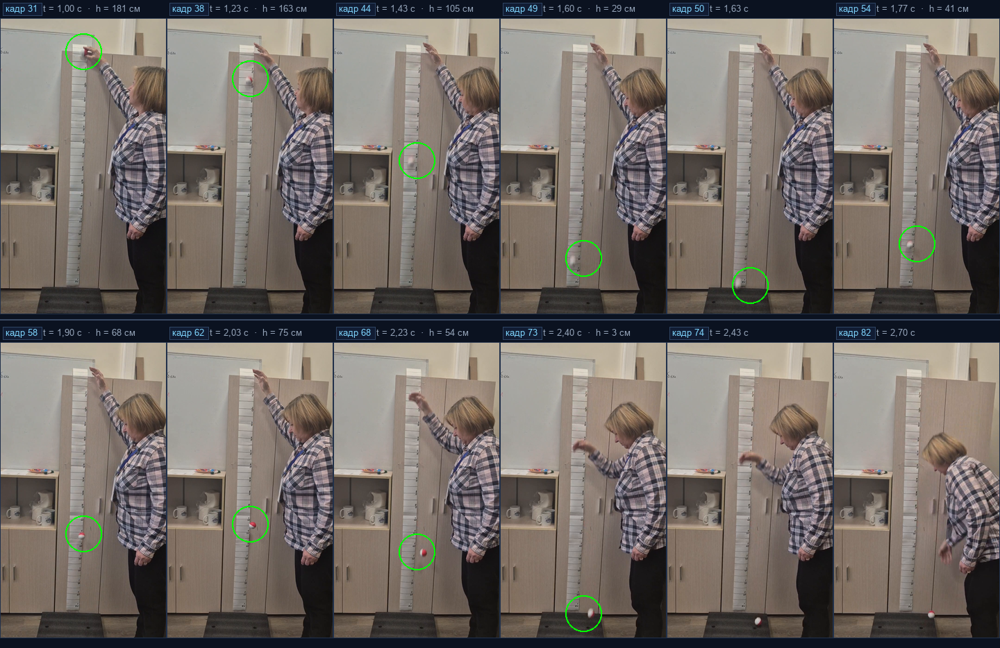
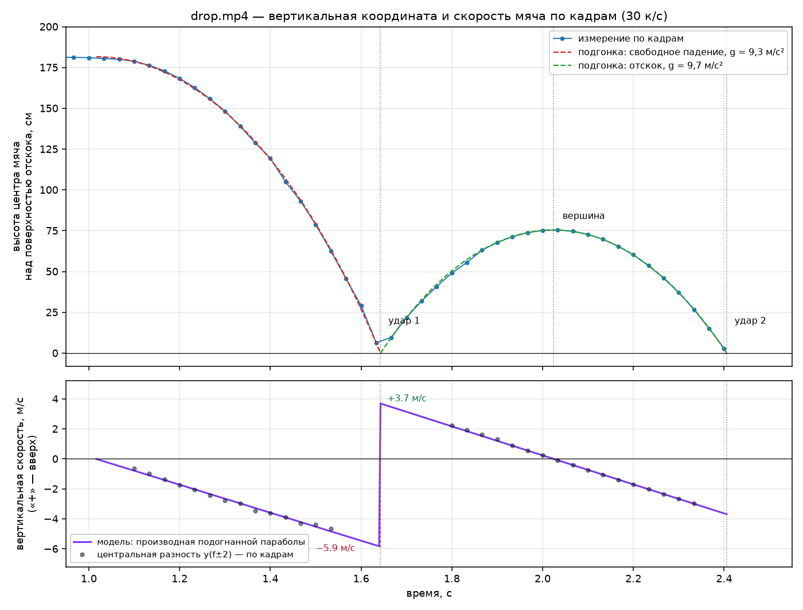

# Покадровый анализ падения мяча — `drop.mp4`

**Итог:** мяч отпущен без начальной скорости с высоты ≈1,82 м, падает 0,63 с, бьётся о мат со скоростью ≈5,9 м/с, отскакивает на 75 см (коэффициент восстановления ≈0,63), затем снова падает и после второго удара остаётся на полу.

---

## 1. Параметры файла

| Параметр | Значение |
|---|---|
| Контейнер / кодек | MP4 (isom), H.264 High, yuv420p, bt709 |
| Разрешение | 720 × 1280 (портрет, 9:16) |
| Частота кадров | 30,000 к/с (tbr 30, tbn 90k) |
| Длительность | 3,63 с |
| Всего кадров | **109** |
| Битрейт видео | 2324 кбит/с |
| Звук | AAC-LC, 48 кГц, стерео, 256 кбит/с |
| Размер файла | 1 177 033 байт |

Кадры извлечены без пропусков (`ffmpeg -vsync 0`), 109 PNG 720×1280 — по одному на кадр. Все дальнейшие координаты — в пикселях исходного кадра, начало координат в левом верхнем углу.

## 2. Что происходит в кадре

Съёмка в учебном кабинете. На дверце шкафа вертикально закреплена бумажная мерная шкала (метки 10…160 см, цена деления 1 см, оцифровка через 10 см). Женщина стоит справа, поднимает руку и прижимает небольшой красно-белый мяч к верхнему краю шкалы (примерно к отметке «0»), затем разжимает пальцы. Мяч падает вдоль шкалы, ударяется о тёмный резиновый мат, лежащий на полу перед шкафом, отскакивает примерно до отметки 103 см по шкале — это ≈75 см над полом (высота от поверхности мата), — снова падает и после второго удара остаётся на полу. В конце записи женщина наклоняется и поднимает мяч.

Диаметр мяча на резких кадрах 23–24 px, что при масштабе 5,7 px/см даёт ≈4,1 см.

Камера снимает с руки (смартфон): за 3,6 с картинка «уезжает» на 3–4 px по горизонтали и на 6 px по вертикали — это учтено в оценке погрешности, но на выводы не влияет.

## 3. Методика

1. **Декодирование.** `imageio-ffmpeg` (FFmpeg 7.1) → 109 кадров PNG, покадрово, без интерполяции.
2. **Детекция мяча** — три взаимодополняющих способа:
   * *по цвету* (кадры 1–40 и 57–73): маска `R − max(G,B) > 45` в полосе x = 250…470 px, центр масс красной части мяча (мяч красно-белый, красный «поясок» смещён от центра не более чем на 2–3 px);
   * *по разности с фоном* (кадры 41–56, где мяч смазан движением и цвет «размывается»): фон — медиана кадров 1–30 (мяч в это время вверху, полоса шкалы чистая), затем порог по положительной разности яркости и центр масс пятна;
   * *по модели* (кадры 50–52, момент удара): мяч полностью смазан, положение восстановлено из подогнанной параболы (в таблице помечены `*`).
3. **Калибровка.** Положения меток 10, 20, …, 160 см считаны с кадров (y = 225, 290, 345, 415, 470, 530, 595, 650, 710, 770, 825, 880, 935, 985, 1040, 1090 px) и аппроксимированы квадратичной зависимостью

   `y(см) = 158,6 + 6,503·Y − 0,004193·Y²`,   СКО остатков 2,5 px (≈0,4 см).

   Квадратичный член нужен потому, что бумажная шкала не идеально плоская: её видимая ширина уменьшается сверху вниз с 62 до 52 px, т.е. масштаб меняется от 6,53 px/см у отметки 0 до 5,16 px/см у отметки 160. Для мяча, который движется в плоскости, параллельной матрице, взят постоянный масштаб **S = 5,70 px/см** (средний по траектории; он же даёт диаметр мяча 4,1 см).
4. **Подгонка.** Два участка полёта аппроксимированы параболами `y = y₀ + v₀t + ½at²` методом наименьших квадратов; точка удара — пересечение парабол.

## 4. Хронология

| Фаза | Кадры | Время, с | Что видно |
|---|---|---|---|
| Удержание | 1–31 | 0,00–1,00 | мяч неподвижен у верхнего края шкалы, y ≈ 141 px (отметка «0») |
| Отпускание | 31–32 | 1,00–1,03 | мяч отрывается от руки, начальная скорость ≈ 0 |
| Свободное падение | 32–50 | 1,03–1,64 | скорость растёт линейно, мяч смазан движением |
| **Удар 1 (мат)** | **≈50,3** | **≈1,64** | y ≈ 1187 px, отметка ≈179 см, v ≈ 5,9 м/с |
| Подъём после отскока | 51–61 | 1,67–2,00 | мяч замедляется, красный «поясок» снова виден чётко |
| **Вершина отскока** | **≈61,7** | **≈2,02** | y = 786 px, отметка 103 см, 75 см над матом, v = 0 |
| Повторное падение | 62–73 | 2,03–2,40 | ускорение снова вниз |
| **Удар 2** | **≈73,2** | **≈2,41** | мяч уходит за край мата, частично перекрыт |
| Затухание | 74–109 | 2,43–3,60 | мяч остаётся на полу; женщина наклоняется (с 74-го кадра) и берёт его |

## 5. Таблица по кадрам

`Y` — координата центра мяча по бумажной шкале (см, 0 — верхний край); `h` — высота центра мяча над поверхностью отскока (мат); `v` — вертикальная скорость (м/с, «+» — вверх). Кадры, отмеченные `*`, восстановлены по модели (сильное смазывание).

| Кадр | t, с | y, px | Y, см | h, см | v, м/с | фаза |
|---:|---:|---:|---:|---:|---:|---|
| 1 | 0,00 | 141 | -3 | 181 | 0,00 | покой |
| 2 | 0,03 | 142 | -3 | 181 | 0,00 | покой |
| 3 | 0,07 | 141 | -3 | 182 | 0,00 | покой |
| 4 | 0,10 | 141 | -3 | 181 | 0,00 | покой |
| 5 | 0,13 | 141 | -3 | 181 | 0,00 | покой |
| 6 | 0,17 | 140 | -3 | 182 | 0,00 | покой |
| 7 | 0,20 | 140 | -3 | 182 | 0,00 | покой |
| 8 | 0,23 | 140 | -3 | 182 | 0,00 | покой |
| 9 | 0,27 | 141 | -3 | 181 | 0,00 | покой |
| 10 | 0,30 | 141 | -3 | 181 | 0,00 | покой |
| 11 | 0,33 | 141 | -3 | 181 | 0,00 | покой |
| 12 | 0,37 | 141 | -3 | 181 | 0,00 | покой |
| 13 | 0,40 | 141 | -3 | 181 | 0,00 | покой |
| 14 | 0,43 | 142 | -3 | 181 | 0,00 | покой |
| 15 | 0,47 | 143 | -2 | 181 | 0,00 | покой |
| 16 | 0,50 | 143 | -2 | 181 | 0,00 | покой |
| 17 | 0,53 | 143 | -2 | 181 | 0,00 | покой |
| 18 | 0,57 | 143 | -2 | 181 | 0,00 | покой |
| 19 | 0,60 | 144 | -2 | 181 | 0,00 | покой |
| 20 | 0,63 | 143 | -2 | 181 | 0,00 | покой |
| 21 | 0,67 | 143 | -2 | 181 | 0,00 | покой |
| 22 | 0,70 | 144 | -2 | 181 | 0,00 | покой |
| 23 | 0,73 | 144 | -2 | 181 | 0,00 | покой |
| 24 | 0,77 | 143 | -2 | 181 | 0,00 | покой |
| 25 | 0,80 | 143 | -2 | 181 | 0,00 | покой |
| 26 | 0,83 | 142 | -3 | 181 | 0,00 | покой |
| 27 | 0,87 | 142 | -3 | 181 | 0,00 | покой |
| 28 | 0,90 | 142 | -3 | 181 | 0,00 | покой |
| 29 | 0,93 | 142 | -2 | 181 | 0,00 | покой |
| 30 | 0,97 | 143 | -2 | 181 | 0,00 | покой |
| 31 | 1,00 | 144 | -2 | 181 | 0,00 | покой |
| 32 | 1,03 | 148 | -2 | 180 | -0,17 | падение |
| 33 | 1,07 | 151 | -1 | 180 | -0,48 | падение |
| 34 | 1,10 | 159 | 0 | 179 | -0,79 | падение |
| 35 | 1,13 | 174 | 2 | 176 | -1,10 | падение |
| 36 | 1,17 | 197 | 6 | 173 | -1,41 | падение |
| 37 | 1,20 | 226 | 10 | 168 | -1,72 | падение |
| 38 | 1,23 | 262 | 16 | 163 | -2,03 | падение |
| 39 | 1,27 | 306 | 23 | 156 | -2,34 | падение |
| 40 | 1,30 | 353 | 30 | 148 | -2,65 | падение |
| 41 | 1,33 | 410 | 40 | 139 | -2,97 | падение |
| 42 | 1,37 | 473 | 50 | 129 | -3,28 | падение |
| 43 | 1,40 | 530 | 59 | 119 | -3,59 | падение |
| 44 | 1,43 | 616 | 74 | 105 | -3,90 | падение |
| 45 | 1,47 | 685 | 86 | 93 | -4,21 | падение |
| 46 | 1,50 | 767 | 100 | 79 | -4,52 | падение |
| 47 | 1,53 | 858 | 116 | 63 | -4,83 | падение |
| 48 | 1,57 | 950 | 133 | 46 | -5,14 | падение |
| 49 | 1,60 | 1037 | 150 | 29 | -5,45 | падение |
| 50 | 1,63 | 1155 | 172 | 6 | -5,77 | падение* |
| 51 | 1,67 | 1139 | 169 | 10 | 3,46 | отскок* |
| 52 | 1,70 | 1076 | 157 | 22 | 3,14 | отскок* |
| 53 | 1,73 | 1024 | 147 | 32 | 2,82 | отскок |
| 54 | 1,77 | 976 | 138 | 41 | 2,49 | отскок |
| 55 | 1,80 | 932 | 130 | 49 | 2,17 | отскок |
| 56 | 1,83 | 896 | 123 | 56 | 1,85 | отскок |
| 57 | 1,87 | 855 | 116 | 63 | 1,53 | отскок |
| 58 | 1,90 | 829 | 111 | 68 | 1,20 | отскок |
| 59 | 1,93 | 809 | 108 | 71 | 0,88 | отскок |
| 60 | 1,97 | 795 | 105 | 74 | 0,56 | отскок |
| 61 | 2,00 | 787 | 104 | 75 | 0,24 | отскок |
| 62 | 2,03 | 786 | 103 | 75 | -0,09 | отскок |
| 63 | 2,07 | 790 | 104 | 75 | -0,41 | отскок |
| 64 | 2,10 | 801 | 106 | 73 | -0,73 | отскок |
| 65 | 2,13 | 818 | 109 | 70 | -1,06 | отскок |
| 66 | 2,17 | 842 | 113 | 65 | -1,38 | отскок |
| 67 | 2,20 | 871 | 119 | 60 | -1,70 | отскок |
| 68 | 2,23 | 907 | 125 | 54 | -2,02 | отскок |
| 69 | 2,27 | 948 | 133 | 46 | -2,35 | отскок |
| 70 | 2,30 | 996 | 142 | 37 | -2,67 | отскок |
| 71 | 2,33 | 1050 | 152 | 27 | -2,99 | отскок |
| 72 | 2,37 | 1110 | 164 | 15 | -3,31 | отскок |
| 73 | 2,40 | 1173 | 176 | 3 | -3,64 | отскок |
| 74 | 2,43 | — | — | — | — | мяч вне линии шкалы |
| 75 | 2,47 | — | — | — | — | мяч вне линии шкалы |
| 76 | 2,50 | — | — | — | — | мяч вне линии шкалы |
| 77 | 2,53 | — | — | — | — | мяч вне линии шкалы |
| 78 | 2,57 | — | — | — | — | мяч вне линии шкалы |
| 79 | 2,60 | — | — | — | — | мяч вне линии шкалы |
| 80 | 2,63 | — | — | — | — | мяч вне линии шкалы |
| 81 | 2,67 | — | — | — | — | мяч вне линии шкалы |
| 82 | 2,70 | — | — | — | — | мяч вне линии шкалы |
| 83 | 2,73 | — | — | — | — | мяч вне линии шкалы |
| 84 | 2,77 | — | — | — | — | мяч вне линии шкалы |
| 85 | 2,80 | — | — | — | — | мяч вне линии шкалы |
| 86 | 2,83 | — | — | — | — | мяч вне линии шкалы |
| 87 | 2,87 | — | — | — | — | мяч вне линии шкалы |
| 88 | 2,90 | — | — | — | — | мяч вне линии шкалы |
| 89 | 2,93 | — | — | — | — | мяч вне линии шкалы |
| 90 | 2,97 | — | — | — | — | мяч вне линии шкалы |
| 91 | 3,00 | — | — | — | — | мяч вне линии шкалы |
| 92 | 3,03 | — | — | — | — | мяч вне линии шкалы |
| 93 | 3,07 | — | — | — | — | мяч вне линии шкалы |
| 94 | 3,10 | — | — | — | — | мяч вне линии шкалы |
| 95 | 3,13 | — | — | — | — | мяч вне линии шкалы |
| 96 | 3,17 | — | — | — | — | мяч вне линии шкалы |
| 97 | 3,20 | — | — | — | — | мяч вне линии шкалы |
| 98 | 3,23 | — | — | — | — | мяч вне линии шкалы |
| 99 | 3,27 | — | — | — | — | мяч вне линии шкалы |
| 100 | 3,30 | — | — | — | — | мяч вне линии шкалы |
| 101 | 3,33 | — | — | — | — | мяч вне линии шкалы |
| 102 | 3,37 | — | — | — | — | мяч вне линии шкалы |
| 103 | 3,40 | — | — | — | — | мяч вне линии шкалы |
| 104 | 3,43 | — | — | — | — | мяч вне линии шкалы |
| 105 | 3,47 | — | — | — | — | мяч вне линии шкалы |
| 106 | 3,50 | — | — | — | — | мяч вне линии шкалы |
| 107 | 3,53 | — | — | — | — | мяч вне линии шкалы |
| 108 | 3,57 | — | — | — | — | мяч вне линии шкалы |
| 109 | 3,60 | — | — | — | — | мяч вне линии шкалы |

## 6. Физика: свободное падение

Подгонка по 18 кадрам (32–49):

`h = 1,815 − 4,63·t²` (h в метрах; t — время в секундах от момента отпускания)

коэффициент при квадрате — это ½g.

* ускорение **a = 5,91 px/кадр²** → при 30 к/с и 5,70 px/см это **g ≈ 9,3 м/с²**;
* начальная скорость на кадре 32 — практически нулевая (мяч отпущен, а не брошен);
* за 0,63 с мяч проходит **1,82 м**; теория для свободного падения без начальной скорости даёт t = √(2h/g) = 0,61 с — совпадение в пределах 3 %;
* скорость у мата по модели **5,86 м/с**; высота 1,815 м даёт по формуле v = √(2gh) = 5,97 м/с.

## 7. Физика: отскок

Подгонка по 17 кадрам (57–73): `h = 3,69·t − 4,86·t²` (h в метрах; t — время в секундах от удара о мат).

* ускорение **a = 6,13 px/кадр²** → **g ≈ 9,7 м/с²** (независимая проверка предыдущего результата);
* скорость сразу после удара **v↑ = 3,69 м/с**;
* **коэффициент восстановления e = v↑/v↓ = 3,69 / 5,86 = 0,63**; по высотам e = √(75,4 / 181,5) = 0,64 — согласуется;
* высота отскока **75 см** (42 % от высоты падения);
* доля потерянной кинетической энергии **1 − e² ≈ 0,60**, т.е. около 60 % энергии уходит в мат, мяч и звук;
* время полёта между двумя ударами **0,76 с** (22,9 кадра); теория 2v↑/g = 0,75 с — совпадение в пределах 2 %;
* импульс, переданный мату, зависит от массы мяча (по видео она не измеряется): `J = m·(v↓ + v↑) = m·9,55`;
  для второго удара `J = m·6,02` (v↓ = 3,69 м/с, v↑ = e·v↓ = 2,33 м/с). В HTML-версии массу можно задать ползунком.

Звуковая дорожка подтверждает кинематику независимо: два резких хлопка на 1,68 с и 2,46 с (по звуку), интервал 0,776 с против 0,763 с по видео — расхождение 1,7 % типично для задержки аудиокодека.

## 8. Проверка согласованности

| Величина | Измерено | Теория / ожидание | Расхождение |
|---|---|---|---|
| Ускорение на падении | 9,3 м/с² | 9,81 | −5 % |
| Ускорение на отскоке | 9,7 м/с² | 9,81 | −1 % |
| Время падения 1,815 м | 0,63 с | 0,61 с | +3 % |
| Скорость у мата | 5,86 м/с | 5,97 м/с | −2 % |
| Время полёта после отскока | 0,76 с | 0,75 с | +2 % |
| Коэффициент восстановления (v) | 0,63 | 0,64 (по высотам) | −2 % |

Небольшое систематическое занижение g (на 3–5 %) объясняется сопротивлением воздуха: мяч разгоняется до ~7 м/с, а для лёгкого полого мяча поправка на лобовое сопротивление как раз составляет несколько процентов.

## 9. Погрешности и ограничения

* **Масштаб.** Главный источник ошибки. Бумажная шкала не плоская (её видимый масштаб меняется на ~25 % по длине), а мяч летит в другой плоскости, поэтому возможна систематика до ±5 % по расстояниям и ±0,5 м/с по скоростям. Отсюда итоговая оценка **g = 9,5 ± 0,5 м/с²**.
* **Дискретность.** 30 к/с даёт шаг 33 мс; субпиксельная интерполяция парабол уточняет моменты ударов до ±5 мс, но отдельный кадр сам по себе «размазан» на 33 мс.
* **Смазывание.** На кадрах 41–56 мяч движется со скоростью до 110 px/кадр (≈2,3 м за кадр) и превращается в штрих длиной 30–50 px — центр определяется с точностью ±5…8 px (±1…1,5 см). Именно поэтому на этих кадрах использована дифференциальная детекция, а на 50–52 — модель.
* **Дрожание камеры** (до ±6 px за запись) даёт медленный дрейф, который почти не влияет на кривизну параболы, но может смещать абсолютные высоты на ±1 см.
* Возможен эффект «роллинг-шаттера» на быстрых кадрах (дополнительное вертикальное растяжение смаза), поэтому кадры 48–52 использованы только как вспомогательные.
* Горизонтально мяч слегка дрейфует: в падении ~8 см/с влево, после удара ~18 см/с вправо — удар о мат дал боковой импульс; на вертикальную динамику это не влияет.

## 10. Выводы

1. Мяч падает **свободно** (начальная скорость ≈ 0), с высоты **≈1,82 м** (центр мяча), время падения **0,63 с**.
2. Ускорение свободного падения, измеренное по двум независимым участкам, **9,3 и 9,7 м/с²** (среднее 9,5 ± 0,5) — согласуется с 9,81 м/с² в пределах погрешности метода.
3. Скорость в момент удара о мат **≈5,9 м/с** (21 км/ч).
4. Удар неупругий: **e ≈ 0,63**, отскок на **75 см**, потеряно **≈60 %** кинетической энергии.
5. Второй удар происходит через **0,76 с** после первого; после него мяч уже не подпрыгивает заметно и остаётся на полу.

## 11. Файлы анализа

| Файл | Содержимое |
|---|---|
| `frames/` | 109 исходных кадров PNG |
| `frames.csv` | покадровая таблица (y, Y, метод) — все 109 кадров |
| `trajectory.png` | график высоты и вертикальной скорости от времени |
| `key_frames.png` | 12 ключевых кадров с обводкой мяча |
| `contact_sheet.png` | контактный лист всех 109 кадров |
| `report.md` | этот отчёт |
| `final_analysis.py` | весь код обработки (детекция, калибровка, подгонка, графики) |
| `make_html.py` | сборка интерактивного HTML |
| `meta.json` | координаты мяча по X для маркера на кадре |
| `check_velocity.py` | сверка скорости по конечным разностям |
| `audio.wav` | звуковая дорожка (8 кГц моно) для проверки моментов удара |
